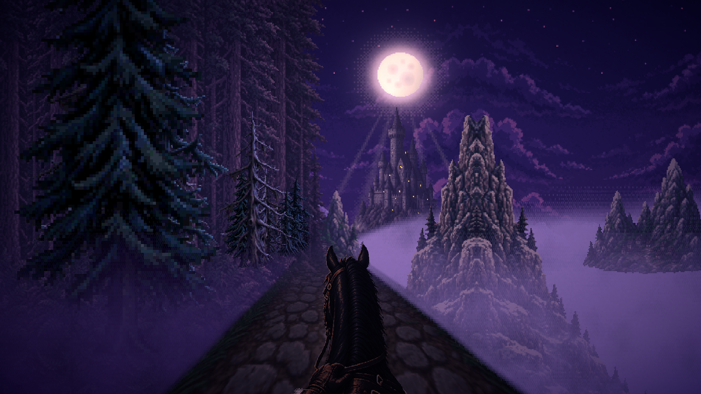
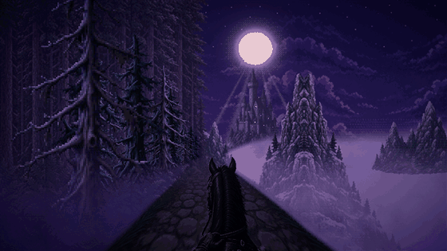
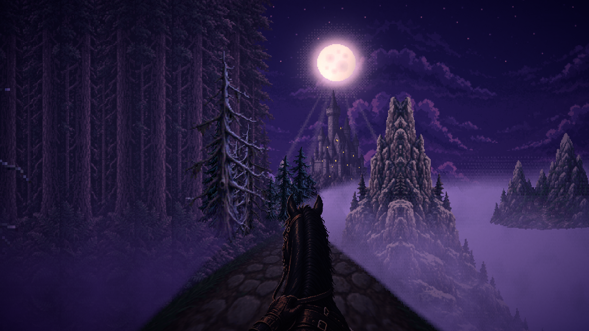
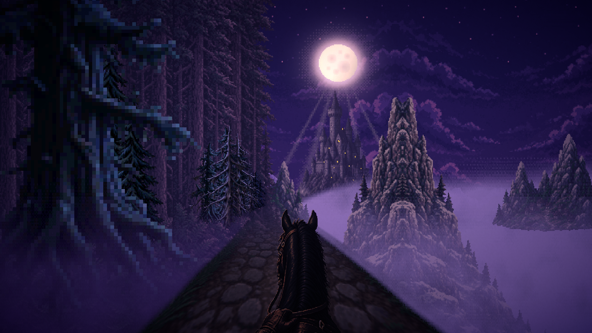
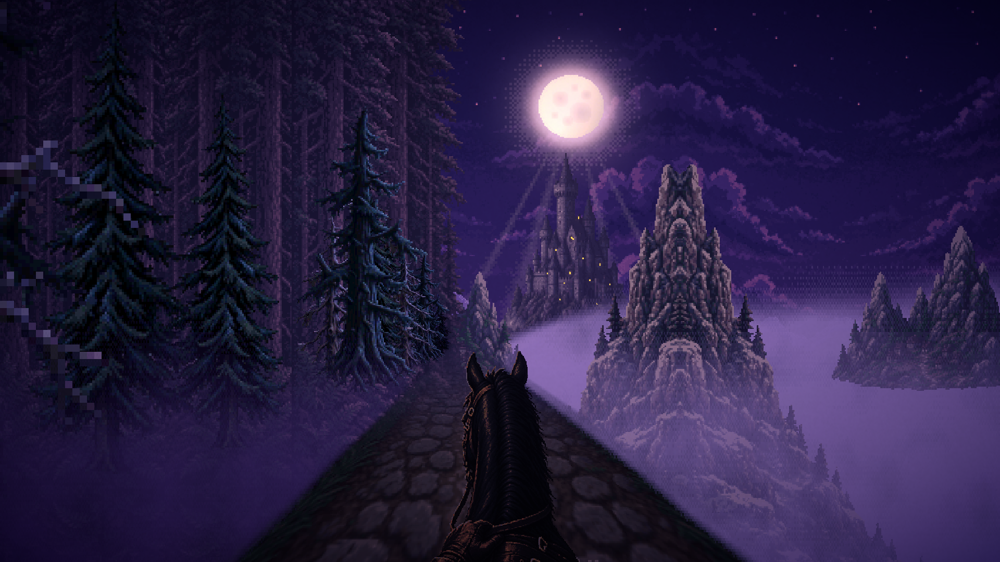

<div align="center">

# Witcher 02: Night Ride

**A first-person 2.5D horse ride through a misty dark-fantasy valley, built from layered pixel art in Unity 6 + URP.**

*Ночная поездка верхом к замку: многослойный пиксель-арт, туман и лунный свет.*




</div>

## About

Witcher 02: Night Ride is the second experiment in my Witcher-inspired series (after
[The Witcher: Moonlit Road](https://github.com/top-secret666/witcher)). You sit in the saddle and ride
along a cobbled road towards a castle under a huge moon. A forest wall stands on the left, and fog banks
roll over the valley on the right.

Everything is a stack of 2D layers on a canvas. A single rig (`HorseRideRig`) turns them into a
convincing first-person ride with perspective, parallax, gait-based camera motion and atmospheric fog.

<div align="center">

<br/><sub>In motion: the road scrolls, the roadside pines rush past and the horse's head nods with the gait.</sub>
</div>

## Features

- **Layered parallax ride.** Sky with moon glow, mountains, castle, valley, cliffs and the forest wall are separate layers with their own zoom/approach/tunnel motion, bob amount and steering parallax.
- **CPU perspective road.** A cobbled path drawn row by row in perspective, with a bend that grows with distance and with steering.
- **Gaits.** Eased speed with walk → canter → gallop, spring camera bob, a lagging head nod and hoof-impact shake.
- **Steering.** `A`/`D` pan the layers with depth-dependent parallax and bank the view slightly. The view drifts back to centre on release.
- **Atmosphere.** Perspective fog banks that thin with distance and fade upward, moon rays behind the castle, plus a URP post-processing profile (`DarkFantasyPost`) with purple/teal shadows, warm highlights and grain.
- **Any aspect ratio.** The pixel render target matches the screen aspect, layers extend sideways, and the rig rebuilds on resize, so there are no black bars at 16:9 or 9:16.
- **Baked scene, runtime fallback.** The **Tools → Build Dark Fantasy Ride** editor menu saves every layer as a real GameObject in `HorseRide.unity` (Sky / Background / Midground / Trees_Left / Road / Fog / Particles / Horse). If those objects are missing, the rig builds the same hierarchy at runtime.

## Screenshots

| | |
|:---:|:---:|
|  |  |
| Riding towards the castle | Steering: the road bends, the layers pan |
|  |  |
| Gallop: pines rush past | The forest wall and fog |

## Controls

| Input | Action |
|-------|--------|
| `W` / `↑` | Ride forward (hold longer to speed up from walk to gallop) |
| `S` / `↓` | Back up |
| `D` / `→`, `A` / `←` | Steer right / left |

## Tech highlights

- **One script, many systems.** `HorseRideRig` holds the layer setup (`ZoomLayer` with Loop / Approach / Tunnel / Static motion), the road projection, fog, gait simulation and input.
- **Screen Space - Camera canvas,** so URP post-processing applies to the 2D layers. A low-res pixel render target is created at Play.
- **Editor tooling.** `DarkFantasyRideBuilder` bakes the hierarchy into the scene, **Tools → Dark Fantasy Ride → Render Preview Frames** renders preview frames, and `RideTextureImporter` enforces point filtering and pixel-art import settings for the ride textures.

## Project structure

```
Assets/
  Resources/Ride/    layer textures (sky, mountains, castle, valley, trees, road, horse)
  Ride/Generated/    textures baked by the editor builder
  Scenes/            HorseRide.unity (main), SampleScene.unity
  Scripts/           HorseRideRig.cs, DarkFantasyPost.cs
  Scripts/Editor/    DarkFantasyRideBuilder.cs, RideTextureImporter.cs
  Settings/          URP pipeline assets
docs/screenshots/    images used in this README
```

## Getting started

1. Install **Unity 6000.6.4f1** (Unity 6).
2. Clone the repo, then in Unity Hub choose **Add → Add project from disk**.
3. Open `Assets/Scenes/HorseRide.unity` and press **Play**.
4. Hold `W` to ride and use `A`/`D` to steer.
